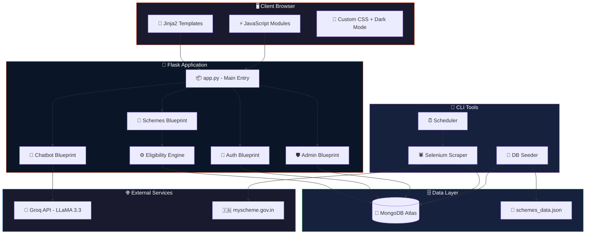
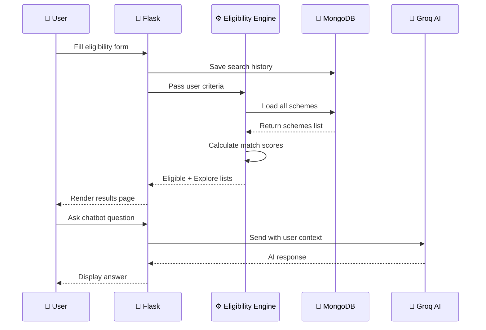
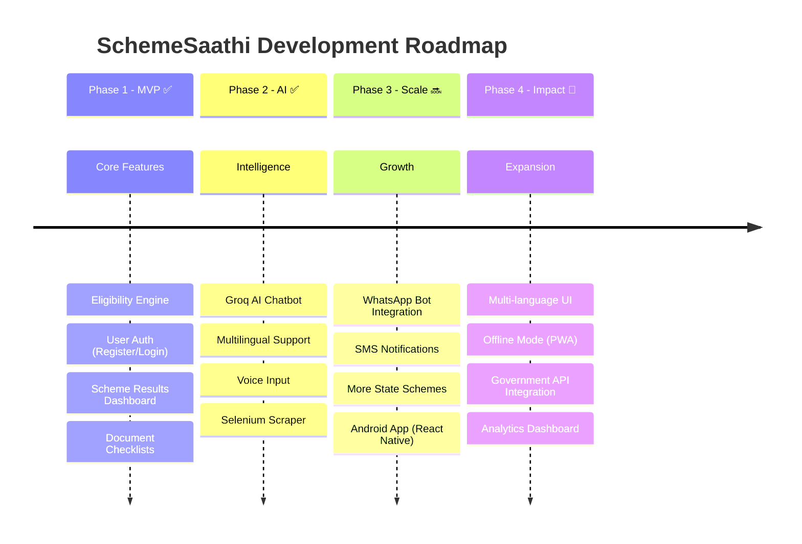

<div align="center">

<!-- Animated Header Banner -->


<!-- Animated Typing SVG -->
<a href="https://readme-typing-svg.demolab.com/"></a>

<br/>

<!-- Dynamic Badges Row 1 -->
[](https://github.com/prajwalzolage55/scheme_finder/stargazers)
[](https://github.com/prajwalzolage55/scheme_finder/network/members)
[](https://github.com/prajwalzolage55/scheme_finder/issues)
[](LICENSE)

<!-- Profile Views Counter -->

[](https://github.com/prajwalzolage55/scheme_finder/commits)
[](https://www.linkedin.com/in/prajwal-zolage-82ab10347)

<!-- Badges Row 2 — Tech Stack -->
<br/>


</div>

---

<!-- Quick Navigation -->
<div align="center">

### 🧭 Quick Navigation

[✨ Features](#-features) · [🏗️ Architecture](#%EF%B8%8F-system-architecture) · [📦 Tech Stack](#-tech-stack) · [🚀 Getting Started](#-getting-started) · [📁 Project Structure](#-project-structure) · [🔌 API Docs](#-api-endpoints) · [🤖 AI Chatbot](#-ai-chatbot---schemesaathi) · [📊 Admin Panel](#-admin-panel) · [🛣️ Roadmap](#%EF%B8%8F-roadmap) · [🤝 Contributing](#-contributing)

</div>

---

## 📖 About The Project

> **SchemeSaathi** (Scheme + Saathi = Scheme Companion) is an AI-powered web platform that helps Indian citizens — especially low-income families — discover, understand, and apply for government welfare schemes they are eligible for.

Millions of rupees in welfare benefits go **unclaimed** every year because citizens don't know which schemes they qualify for. SchemeSaathi solves this by:

- 🎯 **Matching** users to schemes using a multi-criteria eligibility engine
- 🤖 **Answering** questions in **Hindi, Marathi & English** via an AI chatbot
- 📋 **Guiding** users through document checklists and step-by-step application processes
- 🔄 **Auto-fetching** real scheme data from [myscheme.gov.in](https://www.myscheme.gov.in) using Selenium

<div align="center">

```
╔════════════════════════════════════════════════════════════════════╗
║                                                                    ║
║   💡 "Don't Miss Schemes You Deserve"                             ║
║                                                                    ║
║   Ayushman Bharat • PM-KISAN • PMAY • MGNREGA • Ujjwala Yojana   ║
║   ... and 25+ more Central & Maharashtra State Schemes             ║
║                                                                    ║
╚════════════════════════════════════════════════════════════════════╝
```

</div>

---

## ✨ Features

<table>
<tr>
<td width="50%">

### 🎯 Smart Eligibility Engine
Rule-based matching across **8 criteria**:
- 💰 Annual Income
- 🎂 Age Range
- 🚻 Gender
- 🏷️ Caste Category (SC/ST/OBC/General)
- 📍 State & Area Type (Rural/Urban)
- 💼 Occupation
- 📄 BPL Card Status
- 🏦 Bank Account

> Calculates a **match score (0-100%)** and returns eligible + exploratory schemes ranked by relevance.

</td>
<td width="50%">

### 🤖 AI Chatbot — SchemeSaathi
Powered by **Groq's LLaMA 3.3 70B** model:
- 🗣️ **Multilingual**: Hindi, Marathi, English
- 🎙️ **Voice Input**: Web Speech API for accessibility
- 👤 **Context-Aware**: Uses your profile data to personalize answers
- ⚡ **Sub-second responses** via Groq inference
- 🛡️ **Safe**: Never gives legal advice, suggests visiting CSC when unsure

</td>
</tr>
<tr>
<td width="50%">

### 🧾 Document Checklist & Guide
- ✅ Interactive checklists per scheme
- 📝 Step-by-step application guides
- 🔗 Direct links to official portals
- 📎 Know exactly what documents to carry

</td>
<td width="50%">

### 🕷️ Auto Web Scraper
- 🌐 Scrapes **myscheme.gov.in** using Selenium
- 🧠 Smart NLP extraction of eligibility rules
- 🔄 Scheduled auto-refresh (weekly)
- 📡 API interception from Chrome DevTools Protocol
- 🗃️ Upserts directly into MongoDB

</td>
</tr>
<tr>
<td width="50%">

### 🌗 Dark Mode & Responsive UI
- 🎨 Saffron + Navy Indian color theme
- 🌙 Toggle dark/light with persistence
- 📱 Mobile-first responsive design
- ⚡ Fast-loading, works on slow connections

</td>
<td width="50%">

### 🔐 Authentication & Admin
- 👤 User registration with hashed passwords
- 🔒 Session-based auth with Flask sessions
- 🛡️ Admin panel with API key protection
- 📊 Dashboard with database stats & actions

</td>
</tr>
</table>

---

## 🏗️ System Architecture



### Data Flow



---

## 📦 Tech Stack

<div align="center">

| Layer | Technology | Purpose |
|:---:|:---|:---|
|  | **Python 3.10+** | Core backend language |
|  | **Flask** | Lightweight web framework with Blueprints |
|  | **MongoDB Atlas** | Cloud NoSQL database for schemes & users |
|  | **Groq (LLaMA 3.3 70B)** | Ultra-fast AI inference for chatbot |
|  | **Selenium + ChromeDriver** | Headless browser scraping |
|  | **BeautifulSoup4** | HTML parsing & data extraction |
|  | **Jinja2** | Server-side HTML templating |
|  | **Vanilla CSS** | Custom design system (31KB stylesheet) |
|  | **JavaScript (ES6+)** | Chatbot UI, voice input, form validation |
|  | **Web Speech API** | Voice-to-text for accessibility |

</div>

---

## 🚀 Getting Started

### Prerequisites

<table>
<tr>
<td>

```
✅ Python 3.10 or higher
✅ MongoDB (local or Atlas)
✅ Google Chrome (for scraper)
✅ Groq API Key (free tier)
```

</td>
<td>

| Requirement | Get It |
|:---|:---|
| Python | [python.org](https://www.python.org/downloads/) |
| MongoDB | [mongodb.com/atlas](https://www.mongodb.com/atlas) |
| Groq API | [console.groq.com](https://console.groq.com/) |
| Chrome | [google.com/chrome](https://www.google.com/chrome/) |

</td>
</tr>
</table>

### ⚡ Quick Install

```bash
# 1️⃣ Clone the repository
git clone https://github.com/prajwalzolage55/scheme_finder.git
cd scheme-finder

# 2️⃣ Create virtual environment
python -m venv venv

# Activate — Windows
venv\Scripts\activate

# Activate — macOS/Linux
source venv/bin/activate

# 3️⃣ Install dependencies
pip install -r requirements.txt

# 4️⃣ Set up environment variables
copy .env.example .env
# Then edit .env with your keys (see below)

# 5️⃣ Seed the database
python tools/seed_db.py

# 6️⃣ Run the application
python app.py
```

### 🔑 Environment Variables

Create a `.env` file in the root directory:

```env
# 🔐 Flask
SECRET_KEY=your-super-secret-key-change-this

# 🍃 MongoDB Connection
MONGO_URI=mongodb+srv://<username>:<password>@cluster0.xxxxx.mongodb.net/schemefinder?appName=Cluster0

# 🧠 Groq AI (Get free key at console.groq.com)
GROQ_API_KEY=gsk_your_groq_api_key_here

# 🐞 Debug Mode
FLASK_DEBUG=True

# 🛡️ Admin Panel Key
ADMIN_KEY=your-admin-key-here
```

> [!IMPORTANT]
> Never commit your `.env` file. It's already in `.gitignore`.

### 🎉 Access the App

After running `python app.py`, open your browser:

| Page | URL |
|:---|:---|
| 🏠 Home | [http://localhost:5000](http://localhost:5000) |
| 🔐 Login | [http://localhost:5000/login](http://localhost:5000/login) |
| 📝 Register | [http://localhost:5000/register](http://localhost:5000/register) |
| 🎯 Find Schemes | [http://localhost:5000/form](http://localhost:5000/form) |
| 🤖 AI Chatbot | [http://localhost:5000/chatbot](http://localhost:5000/chatbot) |
| 🛡️ Admin Panel | [http://localhost:5000/admin?key=YOUR_KEY](http://localhost:5000/admin?key=YOUR_KEY) |
| ℹ️ About | [http://localhost:5000/about](http://localhost:5000/about) |

---

## 📁 Project Structure

```
scheme-finder/
│
├── 📄 app.py                    # 🚀 Main Flask application entry point
├── 📄 config.py                 # ⚙️ Configuration (env vars, secrets)
├── 📄 requirements.txt          # 📦 Python dependencies
├── 📄 .env                      # 🔐 Environment variables (not committed)
├── 📄 .gitignore                # 🚫 Git ignore rules
│
├── 📂 routes/                   # 🛤️ Flask Blueprints (route handlers)
│   ├── auth.py                  #   🔐 Login, Register, Logout
│   ├── schemes.py               #   🎯 Form, Results, Detail, Checklist, Guide
│   ├── chatbot.py               #   🤖 AI Chatbot (Groq integration)
│   └── admin.py                 #   🛡️ Admin dashboard, fetch trigger, add scheme
│
├── 📂 engine/                   # ⚙️ Core Business Logic
│   └── eligibility.py           #   📊 Multi-criteria matching & scoring engine
│
├── 📂 models/                   # 🗃️ Data Models (MongoDB document shapes)
│   ├── user.py                  #   👤 User & profile schema
│   └── scheme.py                #   📋 Saved scheme schema
│
├── 📂 templates/                # 🎨 Jinja2 HTML Templates
│   ├── base.html                #   📐 Layout (navbar, footer, dark mode)
│   ├── home.html                #   🏠 Landing page with hero & features
│   ├── login.html               #   🔐 Login & Register (dual-mode)
│   ├── form.html                #   📝 Eligibility input form
│   ├── results.html             #   📊 Matched schemes dashboard
│   ├── scheme_detail.html       #   📄 Single scheme deep dive
│   ├── checklist.html           #   ✅ Document checklist
│   ├── guide.html               #   📖 Application step-by-step guide
│   ├── chatbot.html             #   🤖 AI chatbot interface
│   └── about.html               #   ℹ️ About page
│
├── 📂 static/                   # 📁 Static Assets
│   ├── css/
│   │   └── style.css            #   🎨 Complete design system (31KB)
│   └── js/
│       ├── chatbot.js           #   💬 Chat UI logic & API calls
│       ├── form.js              #   📝 Form validation & UX
│       └── voice.js             #   🎙️ Web Speech API integration
│
├── 📂 database/                 # 🗄️ Data Files
│   └── schemes_data.json        #   📊 Seed data (25+ schemes)
│
└── 📂 tools/                    # 🔧 CLI Utilities
    ├── fetch_schemes.py         #   🕷️ Selenium scraper for myscheme.gov.in
    ├── seed_db.py               #   🌱 One-time DB seeder
    └── scheduler.py             #   ⏰ Weekly auto-fetch scheduler
```

---

## 🔌 API Endpoints

### 🌐 Web Routes

| Method | Endpoint | Auth | Description |
|:---:|:---|:---:|:---|
| `GET` | `/` | ❌ | Landing page (redirects to `/home` if logged in) |
| `GET` | `/home` | ❌ | Home page with features showcase |
| `GET` | `/about` | ❌ | About page |
| `GET` | `/register` | ❌ | Registration page |
| `POST` | `/register` | ❌ | Create new account |
| `GET` | `/login` | ❌ | Login page |
| `POST` | `/login` | ❌ | Authenticate user |
| `GET` | `/logout` | ✅ | Clear session and logout |
| `GET` | `/form` | ✅ | Eligibility input form |
| `POST` | `/results` | ✅ | Process form → show matched schemes |
| `GET` | `/scheme/<id>` | ✅ | Scheme detail with match score |
| `GET` | `/checklist/<id>` | ✅ | Document checklist for a scheme |
| `GET` | `/guide/<id>` | ✅ | Step-by-step application guide |
| `GET` | `/chatbot` | ✅ | AI chatbot interface |

### 🤖 API Endpoints

| Method | Endpoint | Auth | Description |
|:---:|:---|:---:|:---|
| `POST` | `/api/chat` | ✅ | Send message to AI chatbot |

**Request:**
```json
{
  "messages": [
    { "role": "user", "content": "Am I eligible for PMAY?" }
  ]
}
```

**Response:**
```json
{
  "reply": "Based on your profile (income ₹1,50,000/year, age 35)..."
}
```

### 🛡️ Admin Endpoints

| Method | Endpoint | Auth | Description |
|:---:|:---|:---:|:---|
| `GET` | `/admin?key=KEY` | 🔑 | Admin dashboard with stats |
| `GET` | `/admin/fetch?key=KEY` | 🔑 | Trigger scheme scraper |
| `GET` | `/admin/add?key=KEY` | 🔑 | Manual scheme entry form |
| `POST` | `/admin/add` | 🔑 | Save manually added scheme |

---

## 🤖 AI Chatbot — SchemeSaathi

<div align="center">

```
╔═══════════════════════════════════════════════════════════╗
║                   🤖 SchemeSaathi AI                      ║
╠═══════════════════════════════════════════════════════════╣
║                                                           ║
║  👤 User: "Mujhe PMAY ke liye kaise apply karna hai?"    ║
║                                                           ║
║  🤖 Bot: "PMAY ke liye apply karne ke steps:             ║
║          1. PMAY website ya CSC centre jaiye              ║
║          2. Online form fill karein                        ║
║          3. Aadhaar, income certificate upload karein     ║
║          4. Reference number note karein                   ║
║          ..."                                              ║
║                                                           ║
╚═══════════════════════════════════════════════════════════╝
```

</div>

### Capabilities

| Feature | Details |
|:---|:---|
| **Model** | Meta LLaMA 3.3 70B Versatile (via Groq) |
| **Languages** | Hindi 🇮🇳 · Marathi · English |
| **Context** | Auto-injects user profile (income, age, caste, state, etc.) |
| **Voice** | 🎙️ Web Speech API for voice-to-text input |
| **Safety** | Never gives legal advice; suggests visiting CSC when uncertain |
| **Speed** | Sub-second responses via Groq's LPU inference |

---

## 📊 Admin Panel

The admin panel provides a management dashboard accessible via API key:

```
http://localhost:5000/admin?key=YOUR_ADMIN_KEY
```

### Admin Features

- 📊 **Database Stats** — Total schemes, Central vs State breakdown, categories
- 🔄 **Fetch Triggers** — Pull new schemes from myscheme.gov.in (runs in background)
- 👩 **Category Fetch** — Target women schemes, Maharashtra schemes, etc.
- ➕ **Manual Entry** — Add schemes with full eligibility rules
- 📋 **Fetch Logs** — View last scraping results and timestamps
- 📜 **Scheme Table** — Browse all schemes with category, ministry, and eligibility rules

---

## ⚙️ Eligibility Engine — How Matching Works

The scoring algorithm in `engine/eligibility.py` evaluates users against scheme rules:

```
┌──────────────────────────────────────────────────────────────┐
│                    SCORING BREAKDOWN                          │
├──────────────────┬───────────────┬───────────────────────────┤
│ Criteria          │ Max Points    │ How It's Scored           │
├──────────────────┼───────────────┼───────────────────────────┤
│ 💰 Income        │ 30 pts        │ User income ≤ max_income  │
│ 🎂 Age           │ 20 pts        │ Within min_age — max_age  │
│ 🚻 Gender        │ 20 pts        │ Exact match               │
│ 🏷️ Caste        │ 20 pts        │ In allowed list           │
│ 📍 Area Type     │ 10 pts        │ Rural/Urban match         │
│ 💼 Occupation    │ 15 pts        │ In allowed occupations    │
│ 🗺️ State        │ 15 pts        │ State scheme match        │
│ 📄 BPL Card      │ 10 pts        │ Required = yes            │
│ 🏦 Bank Account  │  5 pts        │ Required = yes            │
├──────────────────┼───────────────┼───────────────────────────┤
│ TOTAL             │ Variable      │ Score = (earned/max)*100  │
└──────────────────┴───────────────┴───────────────────────────┘

   ✅ Score ≥ 50%  →  "Eligible" (shown first)
   🔍 Score < 50%  →  "Explore" (shown below)
   🚫 Has blockers & score > 40%  →  Capped at 25%
```

---

## 🕷️ Web Scraper Pipeline

The scraper (`tools/fetch_schemes.py`) follows this pipeline:


### Extraction Intelligence

The scraper uses **regex-based NLP** to auto-extract eligibility rules from scheme descriptions:

| Extracted Field | Technique |
|:---|:---|
| Max Income | Pattern: `income.*less than.*₹X lakh` |
| Gender | Keywords: `women`, `female`, `mahila`, `widow` |
| Caste | Keywords: `scheduled caste`, `SC`, `OBC`, `tribal` |
| Area Type | Keywords: `rural`, `urban`, `village`, `city` |
| Occupation | Keyword mapping: `farmer`, `student`, `artisan`, etc. |
| Age Range | Pattern: `aged 18 to 40`, `above 60` |
| BPL | Keywords: `bpl`, `below poverty` |

---

## 🗃️ Database Schema

### Collections

```javascript
// 📋 schemes
{
  id: "pmay",                           // Unique slug
  name: "Pradhan Mantri Awas Yojana",
  category: "Housing",                  // Housing | Health | Education | ...
  ministry: "Ministry of Housing",
  description: "Provides affordable...",
  benefits: "Home loan subsidy up to...",
  eligibility: {
    max_income: 300000,
    area_type: ["rural", "urban"],
    gender: "female",                   // Optional
    caste: ["sc", "st", "obc"],        // Optional
    min_age: 18, max_age: 60,          // Optional
    bpl: true                           // Optional
  },
  documents: ["Aadhaar Card", "Income Certificate", ...],
  apply_link: "https://pmaymis.gov.in",
  apply_steps: ["Visit portal...", "Fill form...", ...],
  state: "central",                     // "central" or state name
  tags: ["housing", "subsidy", "loan"],
  source: "myscheme.gov.in",
  fetched_at: "2026-10-23T00:00:00"
}

// 👤 users
{
  name: "Prajwal",
  email: "user@email.com",
  phone: "9876543210",
  password: "<bcrypt_hash>",
  created_at: ISODate("2026-10-23"),
  profile_complete: false
}

// 🔍 searches
{
  user_id: "ObjectId(...)",
  user_data: { annual_income: 150000, age: 28, ... },
  timestamp: ISODate("2026-10-23")
}
```

---

## 🛠️ CLI Tools

### 🌱 Seed Database
```bash
# Load schemes_data.json into MongoDB (run once)
python tools/seed_db.py
```

### 🕷️ Fetch Schemes
```bash
# Fetch top 50 schemes
python tools/fetch_schemes.py

# Fetch 100 schemes
python tools/fetch_schemes.py --size 100

# Fetch women-specific schemes
python tools/fetch_schemes.py --query "women"

# Fetch Maharashtra state schemes
python tools/fetch_schemes.py --state maharashtra

# Preview without saving
python tools/fetch_schemes.py --preview
```

### ⏰ Auto Scheduler
```bash
# Run weekly auto-fetch (background daemon)
python tools/scheduler.py

# Run all fetch jobs once immediately
python tools/scheduler.py --now
```

**Scheduled Jobs:**
| Job | Query | Size | Description |
|:---|:---|:---:|:---|
| All Schemes | — | 100 | Top 100 from myscheme.gov.in |
| Women | `women` | 50 | Women-specific schemes |
| Agriculture | `farmer` | 50 | Farming & agriculture |
| Education | `scholarship` | 50 | Scholarships & education |
| Health | `health` | 50 | Healthcare schemes |
| Maharashtra | — (state filter) | 50 | MH state schemes |

---

## 🛣️ Roadmap

<div align="center">



</div>

- [x] ✅ Smart eligibility matching engine
- [x] ✅ User authentication (register/login/logout)
- [x] ✅ AI chatbot with Groq (Hindi/Marathi/English)
- [x] ✅ Voice input support
- [x] ✅ Selenium web scraper for myscheme.gov.in
- [x] ✅ Admin panel with fetch triggers
- [x] ✅ Dark mode with persistence
- [x] ✅ Document checklists & application guides
- [x] ✅ Mobile-responsive design
- [ ] 🔜 WhatsApp/Telegram bot
- [ ] 🔜 SMS alerts for new schemes
- [ ] 🔜 More state-level schemes (Gujarat, UP, Karnataka)
- [ ] 🔜 PWA for offline access
- [ ] 🔜 Hindi/Marathi UI translation
- [ ] 🔜 Government API integration (DigiLocker, Aadhaar)

---

## 🤝 Contributing

Contributions are what make the open-source community amazing! Any contributions you make are **greatly appreciated**.

<div align="center">

[](https://github.com/prajwalzolage55/scheme_finder/graphs/contributors)

</div>

```bash
# 1. Fork the repository
# 2. Create your feature branch
git checkout -b feature/AmazingFeature

# 3. Commit your changes
git commit -m "✨ Add AmazingFeature"

# 4. Push to the branch
git push origin feature/AmazingFeature

# 5. Open a Pull Request
```

### 💡 Ideas for Contributions

| Area | Ideas |
|:---|:---|
| 🌍 **i18n** | Add Hindi/Marathi UI translations |
| 📱 **Mobile** | Convert to PWA with service workers |
| 🗺️ **Schemes** | Add schemes for more states |
| 🧪 **Testing** | Add pytest unit tests for eligibility engine |
| 🎨 **UI** | Improve animations, add loading skeletons |
| 📊 **Analytics** | Build a user analytics dashboard |

---

## 📄 License

Distributed under the **MIT License**. See `LICENSE` for more information.

---

## 👨‍💻 Author

<div align="center">

<a href="https://github.com/prajwalzolage55">
  
</a>

### **Prajwal Ashok Zolage**

[](https://github.com/prajwalzolage55)
[](https://www.linkedin.com/in/prajwal-zolage-82ab10347)

</div>

---

## 🙏 Acknowledgments

<div align="center">

| Resource | Purpose |
|:---:|:---|
| 🇮🇳 [myscheme.gov.in](https://www.myscheme.gov.in) | Official government scheme data source |
| 🧠 [Groq](https://groq.com) | Ultra-fast LLM inference (LLaMA 3.3 70B) |
| 🍃 [MongoDB Atlas](https://www.mongodb.com/atlas) | Cloud database hosting |
| 🐍 [Flask](https://flask.palletsprojects.com) | Lightweight Python web framework |
| 🤖 [Selenium](https://www.selenium.dev) | Browser automation for scraping |
| 🎨 [Shields.io](https://shields.io) | Beautiful README badges |
| ✨ [Capsule Render](https://github.com/kyechan99/capsule-render) | Dynamic header images |

</div>

---

<div align="center">


**⭐ If SchemeSaathi helped you, give it a star! ⭐**

<br/>

[](https://github.com/prajwalzolage55/scheme_finder)

*Made with ❤️ in India for India*

<br/>


</div>